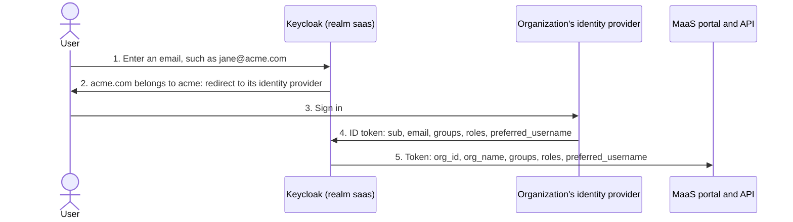
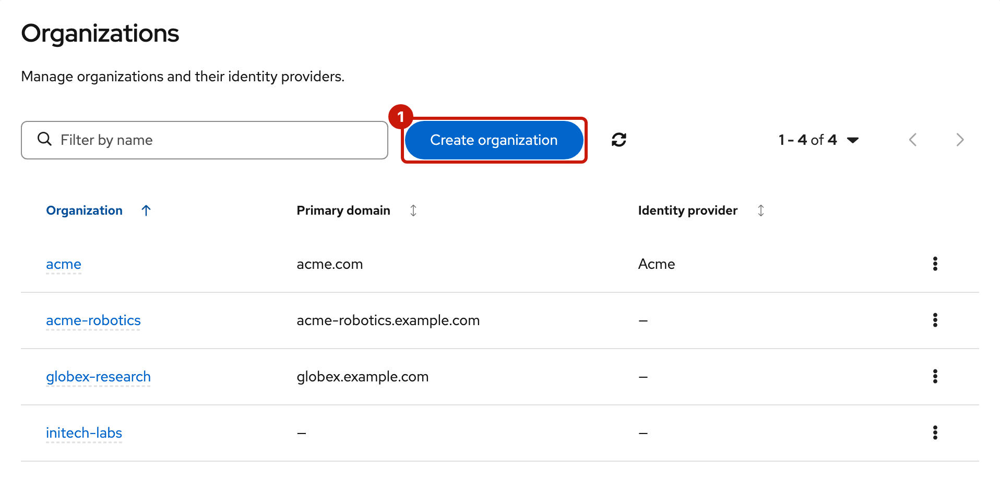
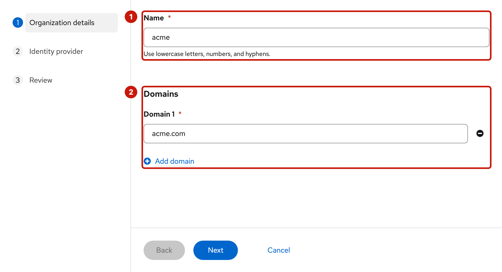
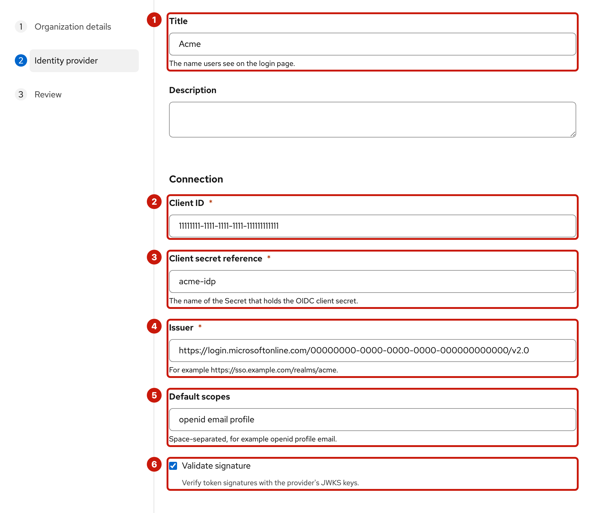
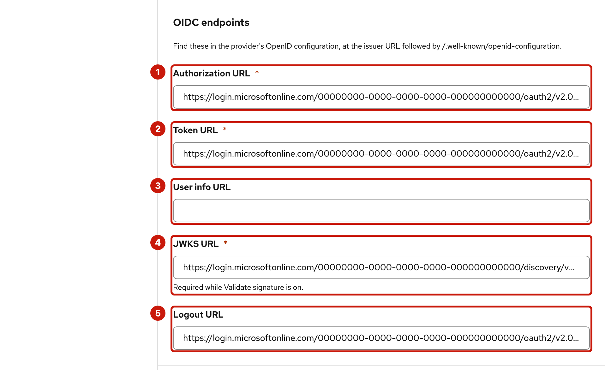
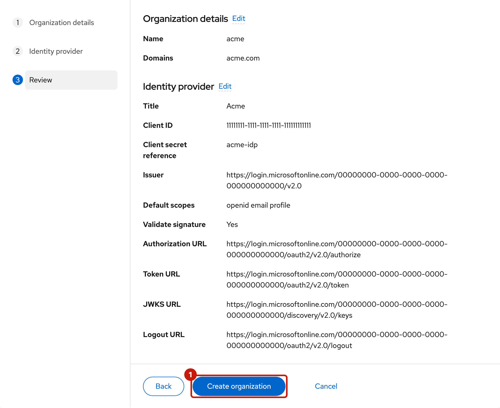
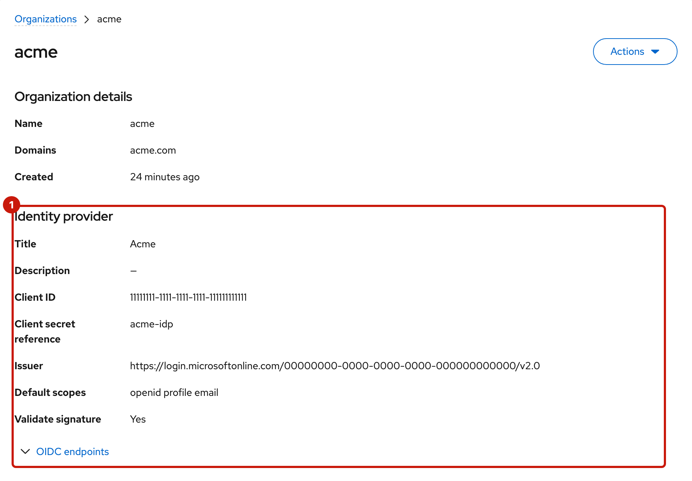
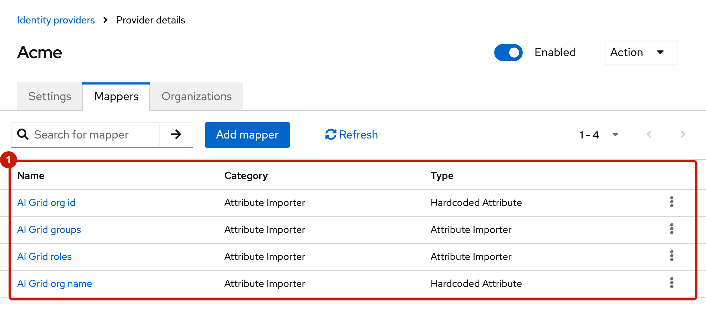
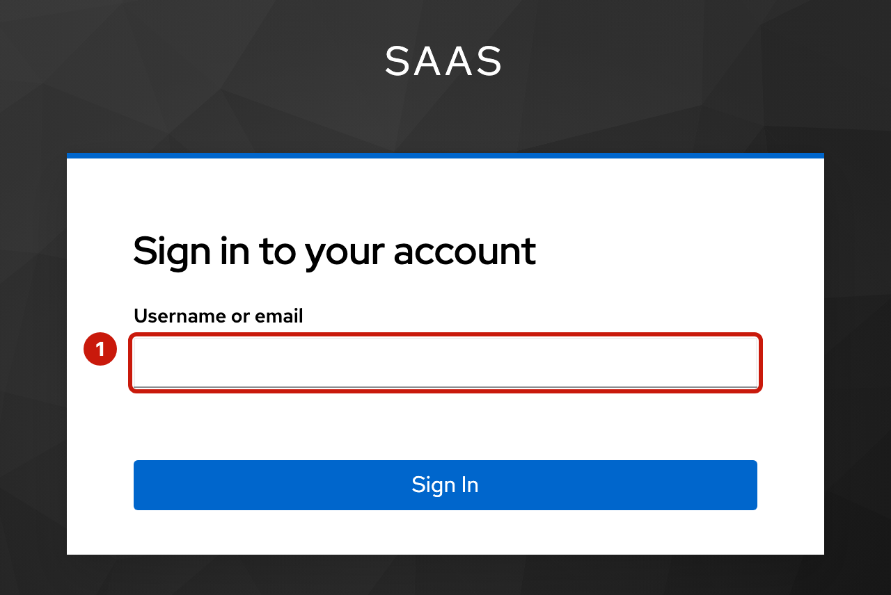
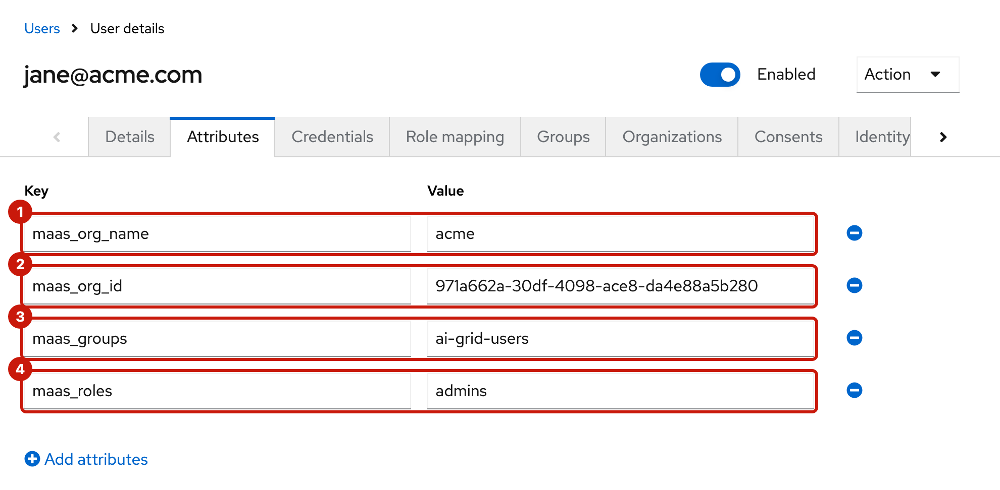

# Organization identity providers

An organization's users sign in to the MaaS portal with their own identity provider: the organization's Microsoft Entra ID, Okta, Keycloak or similar. The provider admin connects it once, in the provider console. Keycloak (realm `saas` on the hub) brokers the sign-in; AI Grid never manages the organization's users.

[Microsoft Entra ID](entra-id.md) is the worked example: its page fills in Entra's side of the steps below.



## What the identity provider must send

The target identity contract is [ODH-ADR-MS-0007](https://github.com/opendatahub-io/architecture-decision-records/blob/main/architecture-decision-records/model-serving/ODH-ADR-MS-0007-ai-grid-shared-oidc-identity-contract.md).
It defines the broker's issuer (`iss`) and subject (`sub`) as the stable user identity.
The ADR specifies ID tokens for browser SSO. The [browserless smoke test](../maas-oidc-smoke/README.md)
still sends access tokens. This branch does not complete that transport alignment.

Keycloak builds its claims from the identity provider's ID token:

| Claim | Value | Used for |
| --- | --- | --- |
| `sub` | A stable id for the user | Links the user's account in `saas` to the identity provider. It must never change. |
| `email` | The user's email | The user's account in `saas`; its domain decides organization membership. |
| `groups` | The user's group names, plain (`ai-grid-users`) | Subscriptions grant models to group names. |
| `roles` | `admins` for the organization's admins | Admin features in the MaaS portal. |
| `preferred_username` | The user's display label, for example `alice` | Shows a readable name in MaaS. This claim is optional. |

The upstream `sub` identifies the account at the company provider. Keycloak
issues a separate broker `sub` for MaaS. A username or email does not identify
the MaaS owner.

Keycloak adds `org_id` and `org_name` for the organization. The identity
provider does not send these claims. At each sign-in, Keycloak copies `groups`,
`roles`, and `preferred_username` from the identity provider. The built-in
`profile` scope reads `maas_preferred_username` for `preferred_username`.

Changes at the identity provider take effect at the user's next sign-in. An
open session and its token refreshes keep the old values until then.

**Verified email.** The MaaS portal refuses a user whose email isn't verified. Keycloak trusts the identity provider's email:

- With `email_verified` in the ID token, Keycloak copies it at every sign-in, so it must be `true`.
- Without it, Keycloak marks the email verified when it creates the user or when the email changes, and leaves the flag as it is at later sign-ins.
- With a User info URL set, Keycloak calls it at every sign-in, and its `email_verified` replaces the ID token's; a response with an email but no `email_verified` makes the email unverified. Leave the User info URL empty for an identity provider whose user info response lacks it, such as Entra ID.

## Connect an identity provider in the provider console

This change requires a fresh installation. The code is not yet deployed.
Create the broker and example realms from this version before onboarding
organizations. Migration of populated realms is outside the scope of this change.

This guide describes the coordinated `harden_user_id_implementation` branches
in this repository and `ai-grid-provider-backend`. Both configure six identity
provider mappers. The backend binds new providers to the built-in
`first broker login` flow. Its local username mapper uses `${UUID}`, target
`LOCAL`, and sync mode `IMPORT`. Its profile mapper copies `preferred_username`
into `maas_preferred_username` with sync mode `FORCE`.

Before onboarding organizations, complete the fresh installation and its realm
sync Jobs. Realm sync requires unique account creation
and updates the shared `profile` scope. The backend does not configure either
realm setting. Realm sync does not update console-created providers.

Do these steps for every organization. [Microsoft Entra ID](entra-id.md) gives Entra's values; for another identity provider, take them from its own documentation.

### 1. Choose the organization's name

The name becomes the Keycloak identity provider's alias, and the alias is part of the redirect URI the identity provider must allow:

```
https://<keycloak-host>/realms/saas/broker/<organization-name>/endpoint
```

- `<organization-name>`: lowercase letters, digits and hyphens, at most 63 characters, for example `acme`. The alias keeps the original name even if the backend later renames the organization.
- `<keycloak-host>`: the host of the hub's Keycloak Route, `oc -n maas-db get route keycloak -o jsonpath='{.spec.host}'`.

### 2. Register the client at the identity provider

Create an OIDC client (a confidential web application) with the redirect URI from step 1, and set it up to send the claims above. Keycloak authenticates to the identity provider's token endpoint by posting the client secret (`client_secret_post`). Keep the client ID and client secret.

### 3. Store the client secret on the hub

The console's backend reads identity provider client secrets from Secrets in namespace `ai-grid-idp-secrets` (the chart value `backend.idpSecrets.namespace`), key `client-secret`. It copies the bytes exactly, so the value must have no trailing newline. As a hub admin:

```sh
oc whoami --show-server   # must be the hub
printf '%s' '<client-secret>' > <file>   # no trailing newline
oc -n ai-grid-idp-secrets create secret generic <organization-name>-idp --from-file=client-secret=<file>
rm <file>
```

### 4. Create the organization

In the provider console: **Organizations**, **Create organization** (1).



The wizard has three steps.

**Organization details**: the Name (1) and the Domains (2).



| Field | Value |
| --- | --- |
| Name | `<organization-name>` from step 1 |
| Domains | The email domains of the organization's users, for example `acme.com` (**Add domain** for more). Lowercase, at least two labels, no IP addresses, at most 64 domains. A domain belongs to one organization only. They're how users reach the identity provider at sign-in, and they can be edited later. |

**Identity provider**: the connection (1–6), then the endpoints (1–5).





| Field | Value |
| --- | --- |
| Title | The name Keycloak shows for the identity provider, for example `Acme`. Empty: the organization's name. |
| Description | Optional. |
| Client ID | From step 2 |
| Client secret reference | `<organization-name>-idp`, the Secret from step 3 |
| Issuer | The identity provider's issuer |
| Default scopes | `openid profile email` (also the default when empty) |
| Validate signature | On (the default). It needs the JWKS URL. |
| Authorization URL, Token URL, User info URL, JWKS URL, Logout URL | From the identity provider's OpenID configuration: the issuer followed by `/.well-known/openid-configuration` |

An organization can be created without an identity provider. The backend also
supports adding one later through `Tenants.Update`.

**Review**, then **Create organization** (1).



The backend creates the organization, its identity provider, and six mappers:
`AI Grid org id`, `AI Grid org name`, `AI Grid groups`, `AI Grid roles`,
`AI Grid local username`, and `AI Grid preferred username`.
The organization's page shows its details and the provider configuration (1) as they were at creation.



In Keycloak's admin console (realm `saas`, **Identity providers**, `<organization-name>`, **Mappers**), the AI Grid mappers (1):



The screenshot shows the first four mappers. The branch also creates
`AI Grid local username` and `AI Grid preferred username`.

For later changes, use the authorized backend API as described below.

### 5. Sign in

Open the MaaS portal on an ingress cluster at
`https://maas.<cluster-apps-domain>/maas-portal`. Enter an email with one of the
organization's domains (1). Keycloak sends the user to its identity provider.
At the first sign-in, Keycloak's built-in first broker login flow adds the new
user to the linked organization when the domain and membership settings allow
it.



To check what a user got, open Keycloak's admin console for realm `saas`. Go to **Users**, the user, and **Attributes**. `maas_org_name` (1), `maas_org_id` (2), `maas_groups` (3), and `maas_roles` (4) become the token's `org_name`, `org_id`, `groups`, and `roles`. `maas_preferred_username` becomes `preferred_username`.



The screenshot shows the first four attributes. `maas_preferred_username`
requires a fresh upstream sign-in. New accounts receive generated local usernames.
Existing accounts keep their local usernames. Two companies can both use `alice` as a display label
while their broker subjects remain separate. Duplicate emails remain disabled.
A matching email stops first sign-in instead of linking two company accounts automatically.

The backend's member response keeps `TenantMember.id` as the broker user ID
and `TenantMember.username` as the local Keycloak username. The separate
`TenantMember.preferred_username` field carries the optional upstream display label.
Use `id` to select a member. A display label can repeat across companies.

### 6. Grant models

In the provider console, create a subscription for the organization with the group names its identity provider sends. Users in those groups see the subscription's models in the MaaS portal.

## Update an identity provider through the backend

`Tenants.Update` can add a provider or change an existing provider in place.
Send the current tenant `id` and `metadata.version`. Set `update_mask` to
`spec.identity_provider` and supply the complete provider object. The backend
preserves the organization ID, provider alias, members, and broker links.

Changing the provider configuration reads its named Secret again and reapplies
the six mappers. Repeating the stored provider object writes nothing.
An organization name change also refreshes the mapper values. A domains-only
update leaves the provider configuration and mappers unchanged.

The backend refuses provider removal. Once users link to the provider, it also
refuses an issuer change. An imported example provider remains GitOps-managed
and is not a backend-managed provider. These rules preserve account identity.

For secret rotation, create a Secret with a new name in `ai-grid-idp-secrets`.
Update `spec.identity_provider.config.client_secret_secret_name` through `Tenants.Update`.
Keep the previous Secret available until the update succeeds. The backend reads
it to restore the previous provider if a later step fails. Updating the old
Secret alone does not trigger a write to Keycloak.

If an update returns `Unavailable`, reload the tenant before retrying.
The backend cannot determine whether the organization update succeeded, and
Keycloak can already use the new provider configuration. If the issuer changed,
wait until the reloaded tenant shows it before testing sign-in.

## Troubleshooting

| What you see | Why, and what to do |
| --- | --- |
| The identity provider rejects the redirect URI, for example Entra's `AADSTS50011` | The redirect URI isn't registered exactly as in step 1: `https`, the organization's name, no trailing slash. |
| Keycloak shows "We are sorry…" and logs a token exchange failure | A wrong client secret can cause this failure. Read the event details for `IDENTITY_PROVIDER_LOGIN_ERROR`. Correct the credentials through the [backend update API](#update-an-identity-provider-through-the-backend). |
| Create organization fails with `identity provider secret "<name>" not found` | The Secret isn't in `ai-grid-idp-secrets`, or has another name. Create it and retry: nothing was left behind. |
| Create organization fails with `tenant "<name>" already exists` | The name, or one of the domains, is already used by another organization. |
| Keycloak shows "We are sorry…" with HTTP `409` and `federated_identity_account_exists` | A local account conflicts with the imported account. Duplicate emails remain disabled. Ask an authorized identity administrator to resolve the conflict. A matching email alone does not prove that two accounts have the same owner. |
| The portal refuses the user after sign-in | The email isn't verified: see [Verified email](#what-the-identity-provider-must-send). |
| The user sees no models | `maas_groups` doesn't hold the subscription's group names, or the user hasn't signed in again since the change. |
| A user who enters an email with no organization's domain sees other organizations' sign-in buttons | The backend hides providers when no organization is resolved. Make sure that the provider sets `kc.org.broker.login.hide-when-org-unknown` to `true`. |
